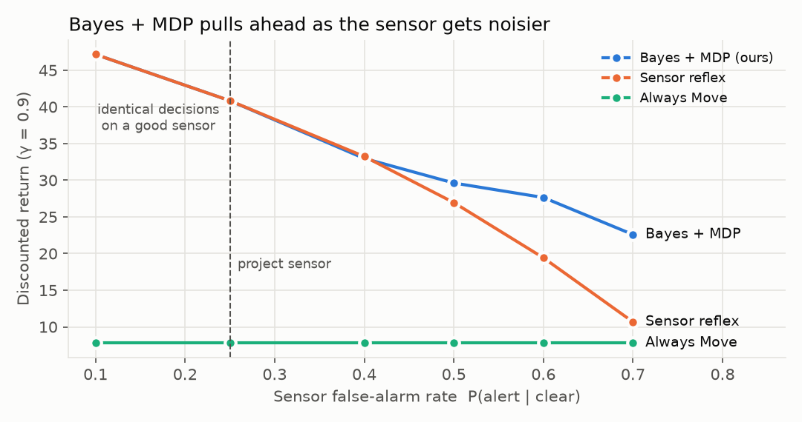
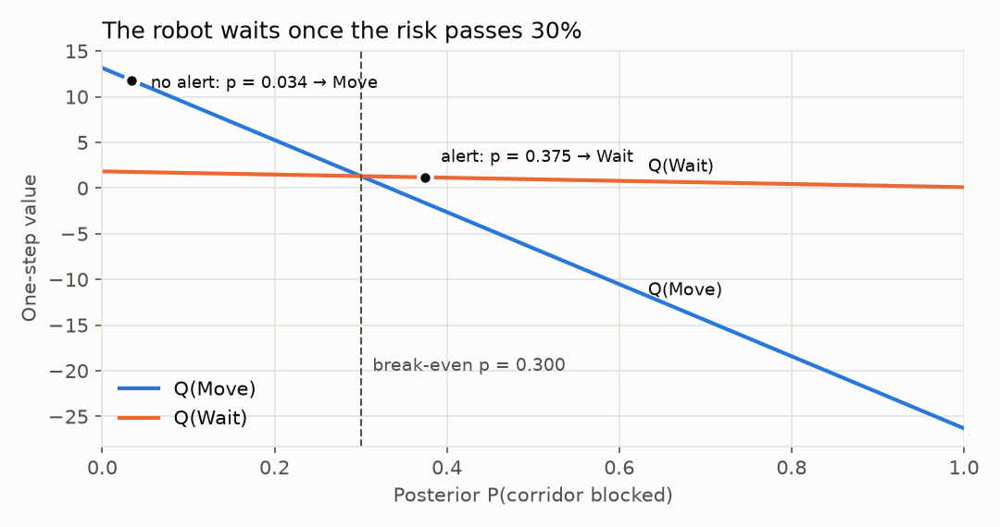

# Mini Campus Delivery Robot

**Course:** AI Fundamentals  
**Project type:** small, reproducible simulation  
**Student/team:** Ramazan G., Merey S., Ali I.

## Project idea

A campus robot must carry a package from a start cell to a destination on a
small grid. It first plans a route, then checks the next corridor with a noisy
sensor. Because the corridor may be blocked, the robot estimates the risk and
decides whether to move or wait.

The three methods support one common goal: deliver the package while avoiding
a potentially blocked corridor.

## Selected syllabus topics

The two main topics were selected from the first seven weeks of the syllabus:

1. **Week 2 — Uninformed search, A* search and heuristics:** A* finds a
   shortest path on the 5×5 campus map using Manhattan distance.
2. **Week 6 — Probability and Bayesian networks:** Bayes' rule updates the
   probability that the next corridor is blocked after a noisy sensor alert.

To meet the Final Project requirement for at least three algorithms from
different topics, the project also uses **Week 5 — Markov decision processes
and reinforcement learning**. The MDP uses a two-state transition model and
one Bellman update to compare `Move` and `Wait`. All selected material is
before Week 8.

## Algorithms and assumptions

### A* search

- Grid: 5×5; start `(0, 0)`; destination `(4, 4)`.
- Walls: `(1, 1)` and `(2, 1)`.
- Each move costs 1. The heuristic is Manhattan distance.
- Ties on `f = g + h` are broken in favour of the larger `g` (the node closer
  to the goal), so A* expands only 9 states, against 23 for uninformed
  uniform-cost search on the same map.
- Output: a shortest route, route length, and number of expanded states.

### Bayesian inference

The sensor is checking whether the next corridor is blocked.

- Prior probability of blockage: `P(blocked) = 0.15`.
- Sensor alert reliability: `P(alert | blocked) = 0.85`.
- False-alert probability: `P(alert | clear) = 0.25`.
- The default demonstration uses an `ALERT` reading.

For an alert:

```text
P(alert) = 0.85 × 0.15 + 0.25 × 0.85 = 0.34
P(blocked | alert) = (0.85 × 0.15) / 0.34 = 0.375
```

### One-step MDP decision

States are `blocked` and `clear`; actions are `Move` and `Wait`. Bayes' posterior
is the current belief over the states. The MDP uses this transition model:

| Action | P(next blocked \| clear) | P(next blocked \| blocked) |
|---|---:|---:|
| Move | 0.10 | 0.80 |
| Wait | 0.05 | 0.40 |

The immediate rewards are:

| Action | Clear corridor | Blocked corridor |
|---|---:|---:|
| Move | +10 | −20 |
| Wait | −2 | +1 |

For a one-step Bellman update, the fixed next-state values are `V(clear) = 5`
and `V(blocked) = −10`, with discount `γ = 0.9`. For each action, the program
calculates `Q(b, a) = Σ_s b(s)[R(s, a) + γΣ_s' T(s, a, s')V(s')]` and selects
the larger value. With the default alert (`P(blocked) = 0.375`), the values
are `Q(Move) = −1.644` and `Q(Wait) = 1.178`, so the robot waits. With no alert,
the posterior blockage probability falls to about `0.034`, and the robot
chooses to move. This is a deliberately small, hypothetical model, not a
trained or production controller.

## Interactive game website

Open `game.html` in a browser. The page is self-contained and needs no install,
server, or internet connection. It presents the project as a playable campus
delivery simulation in a compact two-column autopilot HUD: an isometric campus
map and telemetry on the left, and the linked sensor/Bayes/MDP decision
pipeline on the right.

Use the **Signal: alert** and **Signal: clear** buttons for repeatable
presentation examples; **Check sensor** generates a noisy simulated reading.
The map uses A* to find the shortest path around walls. The **3D FSD view** and
**2D top view** buttons switch the map projection; **X-Ray: A* costs** overlays
per-cell `f/g/h` values, and the lidar scan animates A*'s expanded cells.
A small CSS-3D robot carrying the parcel walks the A* route cell by cell,
turns to face its next move, looks around on `Wait`, recoils when the corridor
turns out to be blocked, and celebrates at the destination. **▶ Автопилот**
lets the robot repeat "check sensor → execute the MDP recommendation" on its
own until the parcel is delivered. After
a sensor reading, the next route cell displays a radar badge with the posterior
risk or clear status. A mission header shows the parcel, destination and
simulated battery; live algorithm cards expose route progress, Bayesian
prior/posterior and Bellman action values. The mission score, turn counter,
risk estimate, and event log update as the robot plays. Open **Defense help**
for a short presentation guide. Press `R` or click **Reset** to restart; `Enter`
executes the recommendation after a sensor reading.

## Run the Python version

Requires Python 3.10 or later; no third-party packages are needed.

```bash
python3 main.py
python3 main.py --no-alert
python3 main.py --test
python3 -m unittest discover -s tests -v
python3 experiment.py
```

The default run prints each algorithm's input, key calculation, output, and a
short explanation. `--no-alert` demonstrates how the Bayesian update changes
the MDP action. `--test` runs the quick built-in checks; the `tests/` suite
(33 unit tests) covers A* optimality from every cell, heuristic admissibility
and consistency, the Bayes and Bellman numbers, the decision threshold and the
simulation. `experiment.py` runs 10,000 simulated deliveries per policy and
writes `results/experiment_results.md` plus two charts (the charts need
matplotlib; everything else uses only the standard library).

## Project structure

| Path | Purpose |
|---|---|
| `main.py` | A*, uniform-cost baseline, Bayes update, one-step MDP, CLI demo |
| `experiment.py` | Monte Carlo comparison of decision policies and sensor-noise sweep |
| `tests/` | Unit tests for `main.py` and `experiment.py` |
| `results/` | Generated tables and charts used in the report |
| `game.html` | Interactive browser demo with the 3D robot and autopilot |
| `REPORT.md` | Technical report |

## Results

Full tables: [`results/experiment_results.md`](results/experiment_results.md).

| Policy (project sensor) | Delivered | Discounted return γ=0.9 | Turns | Collisions |
|---|---:|---:|---:|---:|
| **Bayes + MDP (ours)** | 100% | **40.8** | 12.5 | 0.27 |
| Sensor reflex (alert → wait) | 100% | 40.8 | 12.5 | 0.27 |
| Always Move | 100% | 7.8 | 12.4 | 4.39 |
| Random | 100% | 15.7 | 19.1 | 1.58 |
| Always Wait | 0% | −17.3 | — | 0 |

- Using the sensor cuts collisions with blocked corridors 16-fold compared
  with ignoring it.
- With this fairly reliable sensor the MDP's choices coincide with the simple
  rule "wait on alert" — the break-even risk (0.300) lies between the two
  possible posteriors (0.034 and 0.375).
- When the sensor produces more false alarms, the probabilistic agent pulls
  ahead: at P(alert | clear) = 0.6 it scores 27.6 against 19.4 and delivers in
  12.6 turns instead of 22.8.
- The Bayesian belief is calibrated: decisions made at a predicted risk of
  0.363 met a blocked corridor 36.8% of the time.





## Sample output

```text
Mini Campus Delivery Robot
==========================
Grid: 5x5; start=(0, 0); goal=(4, 4); walls=[(1, 1), (2, 1)]

1) A* route planning
   Heuristic: Manhattan distance; step cost: 1
   Route: [(0, 0), (1, 0), (2, 0), (3, 0), (4, 0), (4, 1), (4, 2), (4, 3), (4, 4)]
   Route length: 8 moves; expanded states: 9
   Uninformed baseline (uniform-cost search) expands 23 states
   Next corridor cell to check: (1, 0)

2) Bayesian sensor update
   Prior P(blocked) = 0.150
   Sensor reading = ALERT
   P(reading) = ... = 0.340
   Posterior P(blocked|reading) = 0.375; P(clear|reading) = 0.625

3) One-step MDP action choice
   State: corridor blocked or clear; actions: Move or Wait
   P(next blocked | clear, Move) = 0.10; P(next blocked | blocked, Move) = 0.80
   P(next blocked | clear, Wait) = 0.05; P(next blocked | blocked, Wait) = 0.40
   Rewards (clear/blocked): Move=+10/-20, Wait=-2/+1; V(clear)=+5, V(blocked)=-10; gamma=0.90
   One-step Bellman value(Move) = -1.644; value(Wait) = 1.178
   Break-even risk: wait when P(blocked) > 0.300
   Recommended action: Wait
```

All outputs are deterministic. The expanded-state count depends on the
tie-breaking rule described above.

## Live demonstration outline

1. Run `python3 main.py` and point out the grid, route, and shortest-path cost.
2. Show the prior, sensor likelihoods, evidence probability, and posterior.
3. Explain the two expected-reward calculations and why the robot waits.
4. Run `python3 main.py --no-alert`; compare the updated probability and
   explain why the action changes to `Move`.
5. Run `python3 -m unittest discover -s tests -v` to show the 33 tests passing.
6. Show `results/noise_sweep.png`: why Bayes + MDP matters once the sensor is noisy.

## Limitations and future development

The map is static, the sensor model and rewards are hypothetical, and the MDP
uses a one-step lookahead with hand-chosen next-state values `V(clear) = 5`,
`V(blocked) = −10` rather than values computed by value iteration. A
future version could add multiple sensor readings, dynamic obstacle updates,
replanning, longer-horizon value iteration, and measured sensor probabilities.
No real campus, student, or personal data is used.

## AI-use declaration

See [`AI_DECLARATION.md`](AI_DECLARATION.md).
