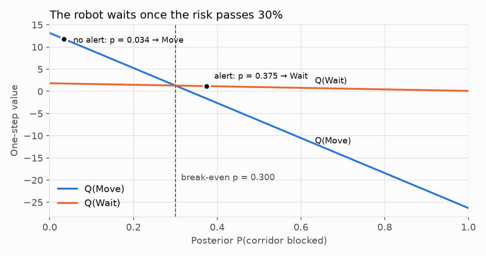
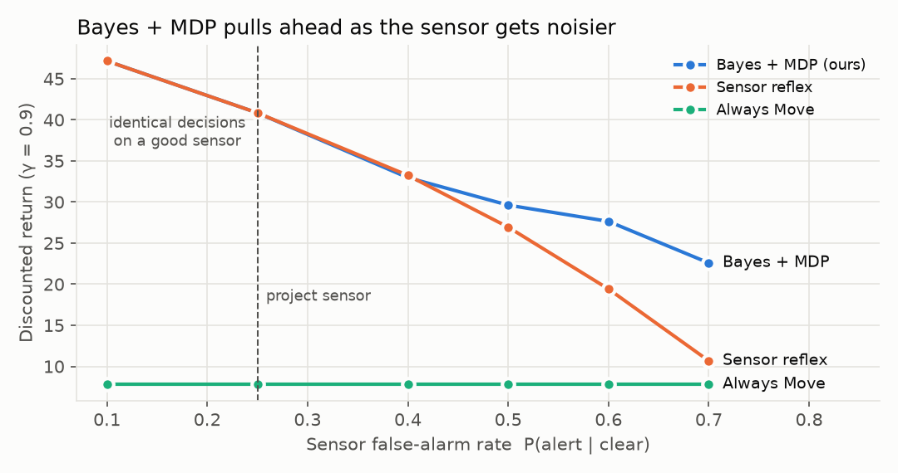

# Mini Campus Delivery Robot — Technical Report

**Course:** AI Fundamentals · **Team:** Ramazan G., Merey S., Ali I.
**Repository:** https://github.com/roma2246/campus-delivery-robot-ai

## 1. Problem statement
Campus delivery robots carry parcels between buildings. Corridors can be
temporarily blocked (people, carts, doors), and the robot's obstacle sensor is
noisy: it sometimes misses an obstacle and sometimes raises a false alarm. The
robot must therefore (1) find a short route, (2) judge how likely the next
corridor is blocked from an unreliable reading, and (3) decide whether to move
now or wait.

## 2. Objectives
- Plan an optimal route on a campus grid with **A\* search** (Week 2).
- Estimate the risk of the next corridor with **Bayes' rule** (Week 6).
- Choose Move or Wait with a **Markov decision process** evaluated by a
  Bellman lookahead (Week 5).
- Show, with tests and a simulation study, that each part is correct and that
  the combination behaves better than simpler strategies.

## 3. Real-world relevance
Delivery robots, warehouse AGVs and autonomous cars face the same chain:
plan → perceive under noise → act under uncertainty. Our model is deliberately
small so that every number can be checked by hand during the defense.

## 4. System overview

```
A* route ──► next corridor ──► noisy sensor ──► Bayes posterior ──► MDP: Move / Wait
   ▲                                                                       │
   └──────────────── robot advances (or waits) and the loop repeats ◄─────┘
```

| Component | File |
|---|---|
| Algorithms and CLI demo | `main.py` |
| Simulation study | `experiment.py` → `results/` |
| Unit tests (38) | `tests/` |
| Interactive warehouse demo (3D forklift, random maps, explanations) | `game.html` |

## 5. Algorithms

### 5.1 A* search
- **Map:** 5×5 grid, start (0, 0), goal (4, 4), buildings at (1, 1) and (2, 1);
  4-connected moves, each costs 1.
- **Heuristic:** Manhattan distance `h(n) = |r − r_goal| + |c − c_goal|`. It is
  *admissible* (never larger than the true distance, because each move changes
  one coordinate by 1) and *consistent* (`h(n) ≤ 1 + h(n′)` for every
  neighbour), so A* returns an optimal path. Both properties are checked for
  every cell in the tests.
- **Tie-breaking:** among nodes with equal `f = g + h`, the one with larger `g`
  is expanded first. Without this rule the search expanded all 23 free cells,
  exactly like uninformed search.
- **Result:** route (0,0)→(1,0)→(2,0)→(3,0)→(4,0)→(4,1)→(4,2)→(4,3)→(4,4),
  **8 moves, 9 expanded states**; uniform-cost search (h = 0) finds the same
  route but expands **23** states.

### 5.2 Bayesian inference
Prior `P(B) = 0.15`; sensor model `P(alert | B) = 0.85`, `P(alert | ¬B) = 0.25`.

After an **alert**:
```
P(alert) = 0.85·0.15 + 0.25·0.85 = 0.1275 + 0.2125 = 0.34
P(B | alert) = 0.1275 / 0.34 = 0.375
```
After **no alert**:
```
P(no alert) = 0.15·0.15 + 0.75·0.85 = 0.0225 + 0.6375 = 0.66
P(B | no alert) = 0.0225 / 0.66 ≈ 0.034
```
During a mission the posterior of one turn, pushed through the transition
model, becomes the prior of the next turn:
`b′ = (1 − b)·T(a, clear) + b·T(a, blocked)`.

### 5.3 MDP decision
States {clear, blocked}; actions {Move, Wait}; discount γ = 0.9.

| | R(clear) | R(blocked) | P(next blocked \| clear) | P(next blocked \| blocked) |
|---|---:|---:|---:|---:|
| Move | +10 | −20 | 0.10 | 0.80 |
| Wait | −2 | +1 | 0.05 | 0.40 |

With next-state values V(clear) = 5, V(blocked) = −10, a one-step Bellman
lookahead over the belief `p = P(blocked)` gives

```
Q(b, a) = Σ_s b(s) [ R(s, a) + γ Σ_s′ T(s, a, s′) V(s′) ]

Expected next value:  Move from clear   0.9·5 + 0.1·(−10) =  3.5
                      Move from blocked 0.2·5 + 0.8·(−10) = −7
                      Wait from clear   0.95·5 + 0.05·(−10) = 4.25
                      Wait from blocked 0.6·5 + 0.4·(−10)  = −1

Q(Move) = (1 − p)(10 + 0.9·3.5) + p(−20 + 0.9·(−7)) = 13.15 − 39.45·p
Q(Wait) = (1 − p)(−2 + 0.9·4.25) + p(1 + 0.9·(−1))  = 1.825 − 1.725·p
```

Worked example (alert, p = 0.375): Q(Move) = −1.644, Q(Wait) = 1.178 → **Wait**.
Without alert (p = 0.034): Q(Move) = 11.805, Q(Wait) = 1.766 → **Move**.
The two lines cross at **p\* = 11.325 / 37.725 = 0.300**: the robot waits
whenever the corridor is more than 30% likely to be blocked.



#### Value iteration: are the hand-set values good enough?

To check the fixed values V(clear) = 5 and V(blocked) = −10, we solve the full
MDP with value iteration, starting from V = 0 and repeating

```
V(s) ← max_a [ R(s, a) + γ Σ_s′ T(s, a, s′) V(s′) ]
```

until no value changes by more than 10⁻⁹ (219 iterations):

| | V* | Optimal action |
|---|---:|---|
| clear | 88.904 | Move |
| blocked | 76.575 | Wait |

The result agrees with solving the two linear Bellman equations of that policy
directly (0.19·Vc − 0.09·Vb = 10, −0.54·Vc + 0.64·Vb = 1). Using V* in the
belief-weighted Q-values (the QMDP approximation) shifts the break-even risk
from 0.300 to **0.310**. After an alert (p = 0.375) the robot still waits
(Q(Wait) = 77.13 > Q(Move) = 74.74), and without an alert (p = 0.034) it still
moves, so the decision rule is not an artefact of the hand-set values.

## 6. Implementation
- **Python 3.10+, standard library only** for the algorithms, demo and tests;
  matplotlib is used only to draw the two charts.
- `main.py` is the reference implementation; `game.html` re-implements the
  same formulas in JavaScript for the interactive demo, and both report the
  same numbers (route of 8 moves, 9 expanded states, 37.5% risk after an
  alert, Q(Move) = −1.64, Q(Wait) = 1.18).
- The browser demo is a warehouse: racks are walls, a 3D forklift robot
  follows the A\* route (expanded cells highlighted, optional f/g/h labels),
  the panel shows the Bayes prior → posterior and the two Q-values, and
  **Autopilot** runs the whole sense → decide → act loop until the robot
  lifts the parcel. A **new map** button places 2–6 racks at random and keeps
  only layouts where a path exists (checked with BFS), showing that A\* is not
  tied to one hand-made map; the assignment's 2-wall map is one click away.
  The **!** buttons open worked explanations of each algorithm.

## 7. Testing
`python3 -m unittest discover -s tests -v` runs **38 tests, all passing**:

| Area | What is verified |
|---|---|
| A\* (11 tests) | path starts/ends correctly, is connected, avoids walls; optimal length from **every** free cell (checked against an independent BFS); heuristic admissible and consistent; A\* expands fewer states than uniform-cost search; invalid start/goal and unreachable goal raise errors; replanning around an added wall |
| Bayes (7) | hand-computed values 0.34 / 0.375 / 0.66 / 0.034; posteriors sum to 1; an alert always raises and silence always lowers the risk; certain priors stay certain; impossible observation raises; Monte Carlo frequency over 200,000 samples matches 0.375 within 0.01 |
| MDP (11) | Q-values −1.644 / 1.178 / 11.805 / 1.766; closed-form lines; break-even 0.300 and the decision flip on each side of it; transition probabilities valid; value iteration converges to the closed-form solution of the Bellman equations (88.904 / 76.575), gives the policy clear → Move, blocked → Wait, and keeps both sensor decisions with threshold 0.310 |
| Demo + simulation (9) | CLI output; reproducible simulation; delivered episodes make exactly 8 moves; Bayes + MDP beats ignoring the sensor; equals the reflex rule on the project sensor and beats it on a noisy one; belief calibration |

## 8. Results
`python3 experiment.py` simulates 10,000 deliveries per policy (seed 2026,
same random start states for every policy, at most 60 turns). Hidden corridor
states evolve with the MDP transition model. Full tables:
`results/experiment_results.md`.

### 8.1 Policy comparison (project sensor)

| Policy | Delivered | Discounted return γ=0.9 (±95% CI) | Total reward | Turns | Collisions | Waits |
|---|---:|---:|---:|---:|---:|---:|
| **Bayes + MDP (ours)** | 100% | **40.8 ± 0.2** | 70.8 | 12.5 | 0.27 | 4.26 |
| Sensor reflex (alert → wait) | 100% | 40.8 ± 0.2 | 70.8 | 12.5 | 0.27 | 4.26 |
| Always Move | 100% | 7.8 ± 1.1 | −7.8 | 12.4 | 4.39 | 0 |
| Random | 100% | 15.7 ± 0.5 | 34.1 | 19.1 | 1.58 | 9.52 |
| Always Wait | 0% | −17.3 ± 0.1 | −105.9 | — | 0 | 60 |

Using the sensor reduces collisions with blocked corridors **16-fold**
(0.27 vs 4.39 per delivery) at the cost of about four short waits, and raises
the discounted return from 7.8 to 40.8.

### 8.2 Sensitivity to sensor noise
Changing only the false-alarm rate `P(alert | clear)`:

| P(alert \| clear) | Bayes + MDP | Sensor reflex | Always Move |
|---:|---:|---:|---:|
| 0.10 | 47.2 (10.5 turns) | 47.2 (10.5) | 7.8 (12.4) |
| **0.25 (project)** | 40.8 (12.5) | 40.8 (12.5) | 7.8 (12.4) |
| 0.40 | 33.0 (11.9) | 33.2 (15.4) | 7.8 (12.4) |
| 0.50 | 29.6 (12.0) | 26.9 (18.3) | 7.8 (12.4) |
| 0.60 | 27.6 (12.6) | 19.4 (22.8) | 7.8 (12.4) |
| 0.70 | 22.6 (12.4) | 10.7 (30.0) | 7.8 (12.4) |



### 8.3 Calibration of the belief
Decisions of the Bayes + MDP agent grouped by the posterior it used:

| Posterior bin | Decisions | Predicted P(blocked) | Observed frequency |
|---|---:|---:|---:|
| 0.0–0.1 | 82,689 | 0.032 | 0.033 |
| 0.3–0.5 | 42,584 | 0.363 | 0.368 |

Predicted and observed risks agree within 0.5 percentage points, which
confirms that the Bayesian update and the belief propagation are correct.

## 9. Discussion
- **Why does Bayes + MDP tie with the simple rule on our sensor?** With
  P(alert | clear) = 0.25 the posterior is either about 0.03 (no alert) or
  0.36–0.38 (alert); the break-even risk 0.300 lies between them, so "wait on
  alert" is exactly the optimal one-step decision. The MDP explains *why* the
  rule is right and *when* it stops being right.
- **When does the probabilistic agent matter?** With a noisier sensor an alert
  no longer means high risk (for example, at P(alert | clear) = 0.6 an alert
  after a clear step gives only about 0.19, below the 0.300 threshold). The reflex keeps waiting on every
  false alarm and needs up to 30 turns; Bayes + MDP ignores weak alerts and
  still delivers in about 12 turns, doubling the discounted return at 0.7.
- **Trade-off.** Measured by plain total reward (no discount), the cautious
  reflex is better on very noisy sensors because it collides less. The
  discount factor encodes how urgent the delivery is; the MDP optimises the
  objective it is given.

## 10. Limitations
- Fixed 5×5 map; the route is not replanned when a corridor stays blocked.
- Sensor probabilities and rewards are illustrative, not measured.
- The robot decides with a one-step lookahead over its belief. Value
  iteration solves the fully observed MDP, but the value of taking another
  sensor reading is not modelled (a POMDP would).

## 11. Future work
- Solve the belief-space MDP (POMDP) so that extra sensor readings have a value.
- Replan with A\* when a corridor is blocked for several turns.
- Use several sensor readings per turn and a learned sensor model.
- Larger campus maps with multiple deliveries.

## 12. Conclusion
A\* gives an optimal route while expanding 9 instead of 23 states; Bayes' rule
turns a noisy reading into a calibrated risk; the MDP turns that risk into an
action through a clear threshold (30%). Together they deliver every parcel in
the simulation, avoid 94% of the collisions that a sensor-blind robot makes,
and stay efficient when the sensor becomes unreliable, where a hand-written
rule breaks down.

## 13. References
1. S. Russell, P. Norvig. *Artificial Intelligence: A Modern Approach*, 4th ed.
   Pearson, 2020 — ch. 3 (A\* search), ch. 12–13 (Bayes' rule, Bayesian
   networks), ch. 16–17 (MDPs, Bellman equation).
2. P. E. Hart, N. J. Nilsson, B. Raphael. "A Formal Basis for the Heuristic
   Determination of Minimum Cost Paths." *IEEE Trans. Systems Science and
   Cybernetics*, 4(2), 1968.
3. R. S. Sutton, A. G. Barto. *Reinforcement Learning: An Introduction*,
   2nd ed. MIT Press, 2018 — ch. 3–4 (MDPs, value functions).
4. S. Thrun, W. Burgard, D. Fox. *Probabilistic Robotics*. MIT Press, 2005 —
   ch. 2 (Bayes filters).
5. AI Fundamentals course materials, weeks 2, 5 and 6.
